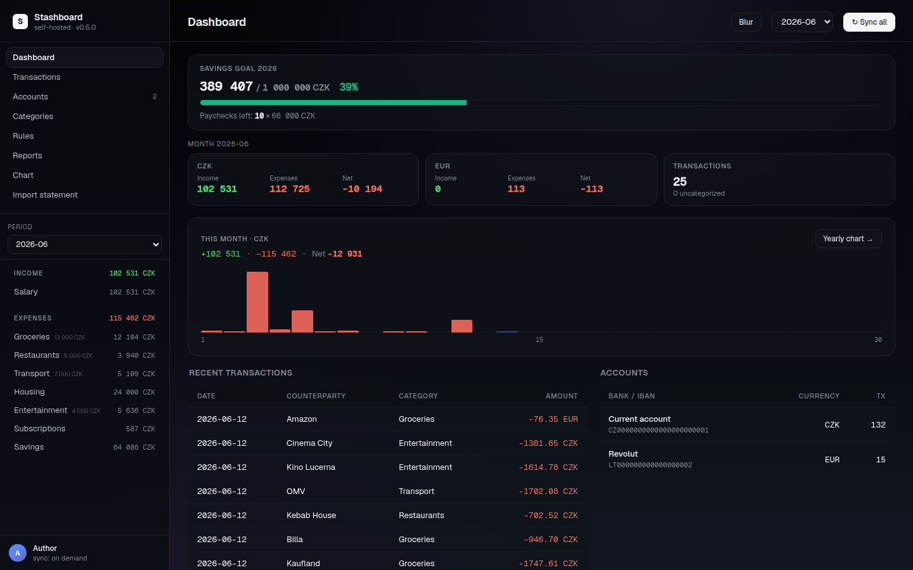

# Stashboard

Self-hosted personal finance dashboard. Aggregates bank transactions from multiple accounts and currencies, categorizes them, and tracks cashflow and savings goals. Runs on any small always-on machine (a home server or single-board computer is enough) and is meant to stay behind a VPN or reverse proxy.

**Status:** v0.5 · single-user · fully usable.



*Demo data generated by `scripts/seed_demo.py` — no real accounts or transactions.*

## Features

- **Bank sync via PSD2** (Enable Banking) — e.g. Revolut, ČSOB SK, Tatra banka — plus CSV import for ČSOB CZ
- **Multi-currency dashboard** — per-currency KPIs, cashflow chart, savings tracker with ETA
- **Auto-categorization** — prioritized regex rules; manual overrides survive re-sync
- **Auth** — Argon2 + signed session cookie, bound to `127.0.0.1` (expose it through your own VPN or reverse proxy)

## Stack

Python 3.13 · FastAPI · Jinja2 · SQLite (WAL) · `uv`. No JS framework, no build step.

## Architecture

```
┌─────────────┐    PSD2 OAuth    ┌─────────────────────┐
│   Browser   │ ───────────────> │  Enable Banking API │
│ (VPN/proxy) │                  └─────────────────────┘
└─────┬───────┘                            │
      │ HTTPS                              │ tx data
      ▼                                    ▼
┌──────────────────────────────────────────────────┐
│  FastAPI app (your server)                       │
│  ┌─────────┐  ┌──────────┐  ┌─────────────────┐  │
│  │ routes/ │─▶│ db.py    │─▶│ SQLite (WAL)    │  │
│  │ main.py │  │ auth.py  │  │ data/finance.db │  │
│  └─────────┘  │csv_import│  └─────────────────┘  │
│               └──────────┘                       │
└──────────────────────────────────────────────────┘
```

## Run

```bash
git clone https://github.com/branislav0/stashboard
cd stashboard
cp .env.example .env       # APP_SECRET_KEY, EB credentials
uv sync
uv run python -m finance.set_password   # set a password
uv run python -m finance.main           # http://127.0.0.1:8000
```

## Run with Docker

```bash
git clone https://github.com/branislav0/stashboard
cd stashboard
cp .env.example .env       # EB credentials (APP_SECRET_KEY is generated for you)
docker compose run --rm stashboard python -m finance.set_password
docker compose up -d       # http://127.0.0.1:8000
```

The database lives in the `stashboard-data` volume; Enable Banking keys are read from
`./.secrets`. The port is published on `127.0.0.1` only — see [SECURITY.md](SECURITY.md).

## License

AGPL-3.0-or-later. See [LICENSE](LICENSE).
